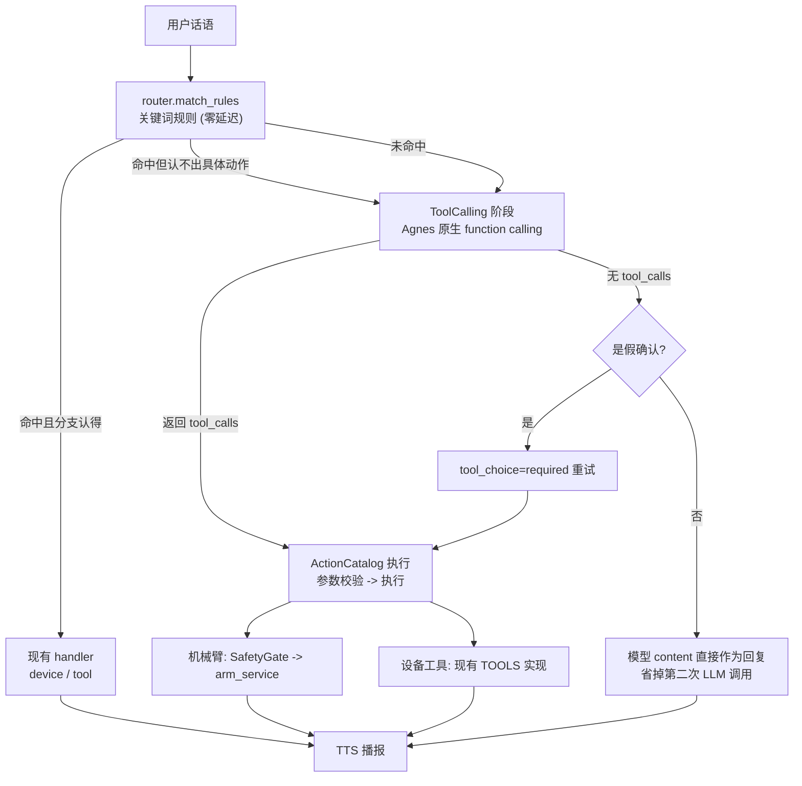

# 动作接入 (Agnes 原生 Function Calling)

Agent 用 **Agnes 的原生 function calling** 来识别用户想执行的动作。
机械臂动作与设备工具共用同一套 tool schema —— 一次 LLM 调用同时完成
「分类意图」和「选动作」。

- 模型: `agnes-2.5-flash` (实测 TTFT ~690ms)
- Endpoint: `POST https://api.agnes-ai.cn/v1/chat/completions`
- 文档: https://www.agnes-ai.cn/zh-Hans/docs/agnes-25-flash

## 整体流程



### 为什么要分两层

| 层 | 触发条件 | 延迟 | 说明 |
|---|---|---|---|
| **规则快速通道** | 关键词命中且分支能匹配到具体动作 | **0ms** | `trust_rules: true` 专门为此设的, 语音体感不受影响 |
| **tool calling 升级路径** | 规则没命中, 或命中了但认不出具体动作 | ~700ms | 一次调用同时完成分类 + 选动作 |

纯规则命中时**完全不调 LLM**, 这条快速通道不能动 —— 它是语音体验的
基础。tool calling 只接管「规则搞不定」的部分。

### 为什么不是「所有请求都带 tools」

试过 (见 `tools/exp_unified_tools.py`), 19 个测试句子的结果:

| 策略 | 符合预期 | 平均延迟 |
|---|---|---|
| 规则优先 (当前) | 12/19 | ~1070ms |
| 一律带 tools | 18/19 | ~6800ms |

**准确率确实更高** —— 模型区分「要执行动作」和「纯闲聊」比规则准。
但有两个问题:

1. **延迟是 6 倍**。规则命中的单动作 23~38ms, 一律带 tools 要 600~2000ms。
   语音场景里这个差距是能感觉到的。
2. **完全依赖 LLM**。免费额度限流 (HTTP 429) 时, 一律带 tools 的路径
   **全线失败** —— 动作类请求直接掉到 chat 分支, 机器人什么都不做。

所以保持「规则优先」。但从实验里学到了两件事, 都已落实:

- **tool_calling 必须有自己的 system_prompt**。之前它被注释掉了, 回落到
  chat 的提示词, 结果模型用文字回答「准备点、挥手」而不调工具 ——
  **说了要做但没做**。现在补上了专用提示词。
- **复合指令不该依赖 LLM**。之前多动作一律升级到 tool calling, LLM 一限流
  整句话就废了。现在规则路径直接按位置排序处理, 零延迟 (实测 800~3000ms
  -> 26~57ms), LLM 挂了也不影响。

### 比原来的实现省了什么

原来规则没命中时是**两段式**:
1. router 用 LLM 分类意图 (`chat` / `tool` / `device`)
2. 分支内部再调一次 LLM 选具体动作名

现在是**一次**调用直接问出「调哪个工具、参数是什么」。

另外, 纯闲聊时模型的 `content` 直接就是回复, 不用再调一次 chat 分支。

## tool 定义

**tool 定义放在 yaml 里** (`configs/tools.yaml`) —— 加一个工具 = 在 yaml 里
加一条, 不用改 Python。

代码侧 (`services/agent_service/action_tools.py`) 只负责把 yaml **加工**成
OpenAI 的 `tools` 数组, 以及执行时分派。

| function | 来源 | 参数 | 说明 |
|---|---|---|---|
| `play_arm_action` | `configs/actions.yaml` (自动生成) | `actions` (enum 数组), `speed` | 机械臂动作, 动作名 = JSON 文件名 |
| `control_light` | `configs/tools.yaml` | `state` (on/off) | 电灯 |
| `control_aircon` | `configs/tools.yaml` | `state` (on/off) | 空调 |
| `play_music` | `configs/tools.yaml` | — | 播放音乐 |
| `query_weather` | `configs/tools.yaml` | `city` | 查天气 (输出型, 要播报) |
| `query_time` | `configs/tools.yaml` | — | 查时间 (输出型, 要播报) |
| `query_date` | `configs/tools.yaml` | — | 查日期 (输出型, 要播报) |

### 机械臂 tool 的 actions 数组

机械臂的 `actions` 是**数组**, 不是单值:

```json
{"actions": ["准备点", "挥手"], "speed": 1.0}
```

- 用户要一个动作 -> `{"actions": ["挥手"]}`
- 用户要多个动作 -> 按他说的顺序填

这是 function calling 的强项 —— LLM 把「先 A 再 B」映射成数组是天然的,
而正则要写「先...然后...」的语法解析器, 换个说法就失效。

数组里**每一项**都会过 enum 校验 —— 模型填了不存在的动作名会在执行前就被
拦下 (不会到服务端才报错)。

整个数组交给 arm_service 排成队列, **只入控一次**。详见
[docs/arm-service.md](arm-service.md#播放队列)。

### yaml 字段说明

```yaml
tools:
  - name: control_light        # function 名, 全局唯一
    kind: device               # arm / device / query
    label: 电灯                 # 中文名, 用于日志与回报
    description: 打开或关闭电灯。  # 给模型看的说明
    speak: true                # 结果是否朗读 (不写则按 kind 推断)
    intent: tool               # 命中后走哪个分支 (不写则按 kind 推断)
    value_arg: state           # 用哪个参数的值决定内部动作名
    action_map:                # 参数值 -> 内部动作名 (TOOLS 表的 key)
      "on": light_on
      "off": light_off
    parameters:                # JSON Schema, 原样透传给模型
      type: object
      properties:
        state:
          type: string
          enum: ["on", "off"]
          description: on=打开, off=关闭
      required: ["state"]
```

| 字段 | 必填 | 默认 | 说明 |
|---|---|---|---|
| `name` | ✅ | — | function 名 |
| `kind` | | `device` | `arm` / `device` / `query` |
| `label` | | 同 `name` | 中文名 |
| `description` | | 空 | 给模型看的说明 |
| `speak` | | 按 kind 推断 | `true` 朗读, `false` 静默 |
| `intent` | | 按 kind 推断 | `chat` / `tool` / `device` |
| `value_arg` | | 空 | 决定内部动作名的参数名 |
| `action_map` | ✅ | — | 参数值 → 内部动作名 |
| `parameters` | | 空 | JSON Schema |

`kind` → `intent` / `speak` 的默认映射:

| kind | intent | speak | 说明 |
|---|---|---|---|
| `arm` | `device` | `true` | 走机械臂分支 (必经安全门阀) |
| `device` | `tool` | `false` | 设备控制, 静默执行 |
| `query` | `tool` | `true` | 信息查询, 念结果 |

> **`action_map` 必填** —— 没有它就无法确定该执行哪个动作, 加载时会被跳过。

### ⚠️ YAML 1.1 的坑: `on` / `off` 必须加引号

```yaml
action_map:
  on: light_on      # ❌ YAML 1.1 解析成布尔值 True
  "on": light_on    # ✅
```

裸写的 `on` / `off` / `yes` / `no` 会被 PyYAML 当成布尔值。加载器做了
兜底 (还原成小写字符串), 但**仍然建议加引号**, 避免依赖兜底逻辑。

### 为什么机械臂是「一个 function + enum」而不是「一动作一 function」

6 个动作就 6 个 function 会让 schema 冗余, 而且模型要在 6 个近似名字里
挑 —— enum 单函数更准。Agnes 文档也要求「工具描述与 JSON Schema 应保持
精确、聚焦」。

机械臂的 tool 是**自动生成**的 (不用在 yaml 里写), 动作名从
`configs/actions.yaml` 读出来枚举成 enum, `description` 里带上说法列表
(`挥手 (挥手、挥个手、挥挥手...)`), 让模型自己把口语映射到动作名:

```
让机械臂执行一个预置动作。可用动作: 挥手 (挥手、挥个手、挥挥手、打个招呼...);
伸左手 (伸左手、左手伸出来...); ...
```

### 设备工具为什么按设备聚合

`light_on` / `light_off` 两个 function vs `control_light(state)` 一个
function —— 后者让模型一次决定「哪个设备 + 什么状态」, 比在两个近似函数
之间二选一准。

### 加工具的完整步骤

1. **在 `configs/tools.yaml` 加一条** —— 描述「模型怎么调」
2. **实现执行逻辑** —— yaml 只管描述, 不管执行:
   - 在 `handlers/tool_handler.py` 的 `TOOLS` 表加内部动作项 (含正则, 给规则路径用)
   - 在 `execute()` 里实现真正的动作
   - 没有实现的话会返回 `failed / 未知动作`
3. **（可选）加规则关键词** —— 想让某个说法走零延迟快速通道, 在
   `configs/agent.yaml` 的 `router.rules` 里加关键词。不加也能用, 只是会走 LLM
4. **校验** —— `python services/agent_service/tools/check_tool_calling.py`

## 关键设计点

### 1. 机械臂动作必须走安全门阀

`ActionCatalog.execute()` 对 `kind="arm"` 的动作一律调用
`DeviceHandler.execute()` —— 那条路径里有安全门阀预检。

**没有任何旁路**: 换成 tool calling 不会绕过安全检查。

### 2. 参数先校验再执行

Agnes 文档明确要求: 「在应用侧执行会产生副作用的操作前, 应先校验工具参数」。

`validate_args()` 按 JSON Schema 检查 type / enum / required:

- 模型幻觉出不存在的动作名 -> enum 校验拦下, 报错里带上合法值
- 参数类型不对 -> 转换或拒绝
- schema 没声明的参数 -> 直接丢弃

### 3. 假确认检测 (最重要的一条)

模型偶尔会跳过工具调用, 直接回答「好的, 帮你关掉空调」——
**设备其实什么都没动**, 用户却以为做了。这叫**假确认**, 是最不能接受的错误。

检测方式: 回复里出现「已完成类」措辞 (`已关闭`、`帮你开`、`完成了`...)
但没有工具调用 -> 用 `tool_choice="required"` **强制重试一次**。

重试也没成功的话, 老实说「抱歉, 我没能执行这个操作」, **绝不假装做完了**。

```python
_FAKE_CONFIRM_MARKERS = (
    "已关闭", "已打开", "已开启", "已关掉", "已开",
    "关掉了", "打开了", "帮你关", "帮你开", "帮你执行",
    "已执行", "已完成", "完成了", "搞定了", ...
)
```

### 4. tool_choice 必须用 `auto`

不能用 `required` —— 否则「今天天气怎么样」这种纯闲聊也会被强行调工具,
反而更差。

`required` 只在假确认重试时用。

### 5. 规则命中但分支认不出具体动作 -> 升级

规则里的关键词有「打开」, 但 `TOOLS` 表的正则要求「打开」后面紧跟
「灯/电灯/台灯」。说「帮我把灯打开」规则命中了, 正则却匹配不上。

这种情况 (且 tool calling 可用) 会升级给模型判断, 而不是直接回
「暂不支持这个操作」。

tool calling 关闭时保持原行为不变。

### 6. tool calling 专用提示词

**不能直接用 `system_prompt`** —— 那是聊天用的, 指令是「回答用户」,
模型会用文字描述动作已完成 (假确认)。

`router.tool_calling.system_prompt` 是专用的:

```
你是一个语音助手, 可以通过工具控制机器人和家电设备。
规则:
1. 如果用户想让你执行一个动作 (控制机械臂、开关灯、开空调、播放音乐、
   查询天气/时间/日期), 你**必须**调用对应的工具, 不要只用文字回答。
2. 绝对不要声称动作已经完成 —— 只有真正调用工具才算执行。
3. 如果用户只是在聊天、提问, 直接简短回答即可, 不要调用工具。
4. 回答用简洁口语化的中文, 总长度不超过 40 个字。
```

### 7. 并行工具调用

模型可能一次给多个 `tool_calls` (实测会)。全部按序执行, 回复合并成一句。

### 8. LLM 不可用时不要再打一次

tool calling 失败 (限流 / 超时 / 网络错误) 时, **不再**去调 `classify_llm`
—— 那只会再失败一次, 白白多一次往返。直接走默认分支。

## 配置

`configs/agent.yaml`:

```yaml
router:
  trust_rules: true          # 规则命中直接采信, 零延迟
  tool_calling:
    enabled: true
    model: agnes-2.5-flash   # 实测 TTFT ~690ms, 比 3.0-flash 稳定
    timeout: 5.0             # 超时直接回落默认分支
    temperature: 0.0
    max_tokens: 256
    tool_choice: auto        # 不要用 required
    max_rounds: 1            # 工具结果回灌轮数 (硬上限, 防死循环)
    feedback_round: false    # 执行后是否让模型再总结一句
    # **必须有专用的 system_prompt** —— 少了它模型会用文字回答
    # 「准备点、挥手」而不调工具, 表现为「说了要做但没做」。
    system_prompt: |
      你是一个语音助手, 可以通过工具控制机器人和家电设备。
      **必须调用工具来执行动作, 不要用文字代替。**
      ...
```

### 各参数怎么调

| 参数 | 建议 | 原因 |
|---|---|---|
| `enabled` | `true` | 关掉就退回原来的两段式 LLM 分类 |
| `model` | `agnes-2.5-flash` | 实测比 `agnes-3.0-flash` 延迟稳定 |
| `timeout` | `5.0` | 语音场景宁可回落到 chat 也不能卡住 |
| `tool_choice` | `auto` | `required` 会让闲聊也去调工具 |
| `max_rounds` | `1` | 每多一轮就多一次往返 (~850ms) |
| `feedback_round` | `false` | 本地固定文案更快, TTS 合成也更快 |
| `system_prompt` | **必填** | 少了它模型会用文字代替调工具 (假确认) |

`feedback_round: true` 时, 工具执行完会把结果回灌给模型, 让它生成一句
更自然的话。代价是多一次往返。

## 自检

```bash
cd services/agent_service

# 离线自检 (112 项, 不需要网络/真机)
python tools/check_tool_calling.py

# 额外验证真实 API 的 tool_calls 解析
python tools/check_tool_calling.py --live

# 对比实验: 「一律带 tools」vs「规则优先」(要消耗 API 额度)
python tools/exp_unified_tools.py
```

覆盖:

1. tool schema 生成 (function 名 / enum 完整性 / required)
2. 参数校验 (非法动作名 / 缺参数 / 类型错 / 空数组 都被拦下)
3. 路由决策 (假 LLM 替身验证规则命中 / tool_calls / 纯 chat / 升级路径)
4. 假确认检测与重试 (含「用嘴列动作清单」这种形态)
5. 动作执行分派 (机械臂走安全门阀, 设备走 TOOLS)
6. 复合指令走规则路径 (LLM 挂了也能执行)

回归:

```bash
python tools/selftest.py
python tools/check_device.py
cd ../arm_service && python tools/check_safety.py
```

## 手动验证

```bash
# 规则命中 -> 应该零 LLM 调用 (trace 里没有 tools 步骤)
curl -s -X POST http://127.0.0.1:8800/v1/dispatch \
  -H 'Content-Type: application/json' \
  -d '{"text":"挥个手","use_history":false}' | python -m json.tool

# 规则未命中 -> 走 tool calling
curl -s -X POST http://127.0.0.1:8800/v1/dispatch \
  -H 'Content-Type: application/json' \
  -d '{"text":"放一首音乐","use_history":false}' | python -m json.tool

# 规则命中但分支认不出 -> 升级到 tool calling
curl -s -X POST http://127.0.0.1:8800/v1/dispatch \
  -H 'Content-Type: application/json' \
  -d '{"text":"帮我把灯打开","use_history":false}' | python -m json.tool
```

## 相关文件

| 文件 | 职责 |
|---|---|
| `services/agent_service/action_tools.py` | 统一动作层: tool 定义 + 参数校验 + 执行分派 |
| `services/agent_service/router.py` | `decide()`: 规则快速通道 + tool calling 升级路径 |
| `services/agent_service/llm.py` | `tool_call()` / `complete_with_tools()` |
| `services/agent_service/app.py` | `dispatch()` 接入 `decide()` |
| `services/agent_service/handlers/device_handler.py` | `execute()`: 安全门阀 + 下发 |
| `services/agent_service/tools/check_tool_calling.py` | 自检脚本 |
