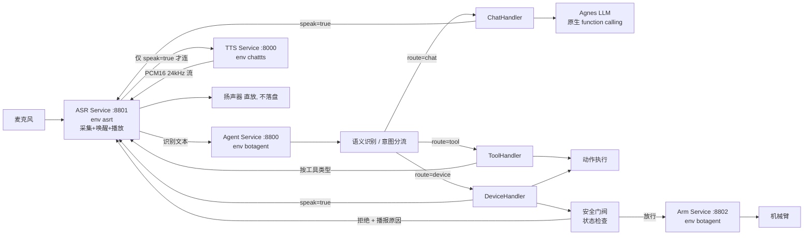

# 模块化机器人语音系统

四个独立进程、三个独立 conda 环境，通过 HTTP / WebSocket 组成一条语音控制闭环。



## 核心语义

1. **ASR 永远是第一环**：`麦克风 → 唤醒词 → 识别文本`，任何输入都从 ASR 起步。
2. **Agent 做语义识别并分流**：拿到文本后判断意图，决定走哪个分支。
3. **分支决定下游去向**：
   - `chat` 分支 → `speak=true` → 进 TTS 合成 → 扬声器播放
   - `tool` 分支 → 分两种：
     - **执行型**（开灯、播放音乐）→ `speak=false` → 直接执行动作，不进 TTS
     - **输出型**（查天气、查时间）→ `speak=true` → 结果经 TTS 播报
   - `device` 分支 → **安全门阀** → 放行则驱动机械臂 → `speak=true` 播报结果
4. **不保存本地**：识别音频只在内存；TTS 的 PCM 边收边播，不写文件。

## 目录结构

```
Bot Agent/
├── services/
│   ├── asr_service/          # 源自 project/ASRT
│   │   ├── wakeup_asr.py     # 原样保留采集/唤醒/VAD
│   │   ├── server.py         # 新增: 采集线程 + /health + /state
│   │   ├── pipeline.py       # 新增: ASR->Agent->(TTS->播放) 状态机
│   │   ├── agent_client.py   # 新增: 调用 Agent 分流接口
│   │   ├── tts_client.py     # 新增: ChatTTS WS 客户端 + 直放
│   │   └── config.py         # 新增: 读 configs/pipeline.yaml
│   ├── tts_service/          # 源自 project/ChatTTS (含 853MB 权重)
│   │   └── examples/ws_server/   # 原样复用, 协议不动
│   └── agent_service/        # 新增
│       ├── app.py            # FastAPI 路由
│       ├── config.py         # 读 configs/agent.yaml + configs/.env
│       ├── llm.py            # Agnes 客户端 (含原生 tool calling)
│       ├── session.py        # 会话历史
│       ├── router.py         # 意图分流 (规则 + tool calling)
│       ├── registry.py       # 分支注册表
│       ├── action_tools.py   # 统一动作层 (tool 定义 + 参数校验 + 执行)
│       └── handlers/         # chat / tool / device
│   └── arm_service/          # 新增: 机械臂动作服务
│       ├── main.py           # FastAPI 入口 (HTTP + WebSocket)
│       ├── service.py        # 播放编排 (入控 -> 对齐 -> 播放 -> 停控)
│       ├── library.py        # 动作库加载 (一个 JSON 文件 = 一个动作)
│       ├── safety.py         # 安全门阀 (状态检查 + 拒绝原因)
│       ├── notifier.py       # 门阀拒绝时的 TTS 播报
│       ├── timeline/         # 时间轴模型 / 插值 / 播放引擎
│       ├── robot/            # 控制面连接 / UDP 关节流 / 控制状态机
│       └── data/             # 动作序列 JSON
├── configs/
│   ├── agent.yaml
│   ├── tools.yaml             # tool 定义 (模型看到的工具清单)
│   ├── actions.yaml          # 机械臂「说法 -> 动作名」映射
│   ├── arm.yaml              # 机械臂服务配置
│   ├── tts.yaml              # TTS 音色 + 模型配置
│   ├── pipeline.yaml
│   └── .env                  # 密钥, 不入库
├── scripts/
│   ├── start_all.sh / stop_all.sh
│   ├── start_tts.sh / start_agent.sh / start_asr.sh / start_arm.sh
│   ├── smoke_test.sh          # 三段式联通自检
│   └── full_chain_test.sh     # 端到端: 回放 -> 分流 -> TTS -> 播放 -> 断言
└── docs/
    ├── architecture.md
    ├── action-integration.md  # 动作接入 (function calling)
    ├── arm-service.md         # 机械臂服务
    └── testing.md
```

## Conda 环境

| 服务 | 环境 | Python | 关键依赖 |
| --- | --- | --- | --- |
| ASR | `asrt` | 3.10 | vosk 0.3.45、sounddevice、requests、websockets、pyyaml |
| TTS | `chattts` | 3.11 | torch 2.6、fastapi、uvicorn、websockets |
| Agent | `botagent` | 3.11 | fastapi、uvicorn、httpx、pyyaml、pydantic |
| Arm | `botagent` | 3.11 | fastapi、uvicorn、websockets、pyyaml |

vosk 中文模型在 `~/.cache/vosk/`（`vosk-model-cn-0.22`、`vosk-model-small-cn-0.22`），无需下载。

## 关键配置

### `configs/pipeline.yaml`（ASR 侧）

```yaml
asr:
  # 唤醒词。可自定义, 支持两种写法:
  #   1) 逗号分隔字符串: "你好助手,小助手"
  #   2) YAML 列表:      ["你好助手", "小助手"]
  wake_words: "你好助手"

  # 没识别到内容时的播报文案 (会经 TTS 播报出来); 留空表示不播报。
  # 同一句话也用于 /state 的 errors 记录, 保证日志与播报一致。
  empty_result_prompt: "没听清内容，请再说一遍"

  # 连续对话窗口 (秒)。一轮播报完成后, 这段时间内再次说话无需唤醒词。
  # 从「播报结束」开始计时 (机器人说话的时间不占用用户的窗口)。
  # 设为 0 关闭连续对话。
  continuous_timeout: 30.0
```

可用环境变量覆盖：`ASR_WAKE_WORDS` / `ASR_EMPTY_RESULT_PROMPT` / `ASR_CONTINUOUS_TIMEOUT`。
命令行 `--wake` / `--continuous-timeout` 优先级最高。

> 唤醒词必须能被 vosk 模型词表切分，否则启动时会提示并忽略该词。
> 启动日志会打印实际切分结果，例如 `唤醒词: 你好助手 (词表切分: 你好 + 助手)`。

#### 连续对话的状态流转

```
IDLE ──唤醒词──> RECORDING ──识别完成──> THINK ──speak──> SAY ──播完──> IDLE
                  ↑                                                 │
                  └────────────── 窗口内(30s) 检测到人声 ←───────────┘
                                    窗口过期 → 必须重新唤醒
```

连续对话窗口内用 VAD 判断「用户是否开口」，检测到人声才开始录音 ——
否则环境噪声会被当成用户开口，白等一个静音超时。

前滚音频（补上开口前 0.5 秒，避免吞掉第一句话）会**排除 TTS 播放期间
录到的声音**，否则下一轮会把机器人的声音当成用户的话识别出来。

### `configs/agent.yaml`（Agent 侧）

```yaml
llm:
  model: agnes-2.5-flash   # agnes-3.0-flash 首字延迟波动大 (1.5s~33s), 语音场景别用
  max_tokens: 256          # 限制生成长度 -> 直接降低 TTFT 和 TTS 合成时长
router:
  mode: hybrid            # rules | llm | hybrid
  default_route: chat
  llm_timeout: 1.2        # 路由分类超时, 超过就回落 default_route
  trust_rules: true       # 规则命中就信, 跳过 LLM 二次确认 (省 1~3 秒)
  # 原生 function calling: 规则没命中时才走, 一次问出「调哪个工具、参数」
  tool_calling:
    enabled: true
    model: agnes-2.5-flash
    timeout: 5.0
    tool_choice: auto     # 不要用 required
  rules:
    - intent: tool
      keywords: ["打开", "关闭", "设置"]
      exclude: ["怎么样", "如何", "为什么"]
```

> `configs/.env` 里的 `LLM_MODEL` **会覆盖** YAML 的 `llm.model`。
> 改完 YAML 记得同步改 `.env`，否则「配置改了没效果」。

### `configs/actions.yaml`（机械臂说法映射）

动作名 = `arm_service/data/` 里的 JSON 文件名。匹配时命中**最长的说法**，
所以「伸左手」永远赢过「伸手」，排列顺序不影响结果。

```yaml
arm:
  base_url: "http://127.0.0.1:8802"
  exclude: ["怎么样", "如何", "为什么", "怎么"]
  actions:
    - action: "挥手"
      say: ["挥手", "挥个手", "挥挥手", "打个招呼"]
    - action: "伸左手"
      say: ["伸左手", "左手伸出来", "伸出左手"]
```

## 启动

```bash
# 四个服务一起起（会等健康检查通过）
./scripts/start_all.sh

# 或分别启动
./scripts/start_tts.sh      # env chattts, :8000
./scripts/start_agent.sh    # env botagent, :8800
./scripts/start_asr.sh      # env asrt, :8801
./scripts/start_arm.sh      # env botagent, :8802

# 停止
./scripts/stop_all.sh
```

### 端到端自检

```bash
./scripts/full_chain_test.sh            # 自动拉起三个服务 (TTS/Agent/ASR), 回放真实录音, 断言分流与播放
./scripts/smoke_test.sh                 # 只做三段式联通检查
```

`full_chain_test.sh` 会验证：识别文本 → `chat` 分支 `speak=true` → TTS 直放；
`tool` 分支 `speak=false` 不进 TTS；以及全程没有任何音频文件落盘。

ASR 服务也支持透传参数：

```bash
./scripts/start_asr.sh --wake "你好助手"
./scripts/start_asr.sh --replay /path/to/16k_mono.wav   # 不占麦克风
./scripts/start_asr.sh --replay x.wav --no-wake         # 跳过唤醒词, 只验下游链路
./scripts/start_asr.sh --replay x.wav --keep-alive 60   # 回放后保留 HTTP 60s 便于读 /state
```

## 接口契约

### Agent Service `:8800`

`POST /v1/dispatch` — 分流并执行（ASR 主用）

```json
// 请求
{"session_id": "robot-01", "text": "打开空调", "use_history": true}

// 响应
{
  "session_id": "robot-01",
  "text": "打开空调",
  "intent": "tool",
  "route": ["tool"],
  "speak": false,
  "reply": "已执行 light_on",
  "action": {"name": "light_on", "args": {"raw": "打开空调"}, "status": "ok", "detail": "灯已打开"},
  "latency_ms": 42,
  "trace": [{"step": "rules", "ms": 0.3, "detail": "tool:打开"}]
}
```

| 字段 | 含义 |
| --- | --- |
| `intent` / `route` | 语义识别得到的意图与命中分支 |
| `speak` | `true` = 回复文本需经 TTS 朗读；`false` = 不朗读 |
| `reply` | 面向用户的短文本（`speak=true` 时是朗读内容） |
| `action` | 工具类分支的动作与执行结果 |
| `trace` | 各阶段耗时与判定依据，调试用 |

其它接口：

- `POST /v1/chat` — 只做对话，跳过分流
- `POST /v1/chat/stream` — SSE 流式对话，事件 `delta` / `done` / `error`
- `GET /health` — `{"status":"ok","model":"...","branches":[...],"router_mode":"hybrid"}`
- `GET /v1/branches` — 各分支启用状态

### ASR Service `:8801`

- `GET /health` — `{"status":"ok","state":"IDLE","wake_words":["你好助手"],...}`
- `GET /state` — 最近一轮的 `last_text` / `last_intent` / `last_speak` / `last_reply` / `last_action` / `errors`

状态机：`IDLE → REC → THINK → SAY → IDLE`，其中 `SAY` 只在 `speak=true` 时进入。

> 没识别到内容时也会进入 `SAY`，播报 `empty_result_prompt`（如「没听清内容，请再说一遍」）。

### TTS Service `:8000`

复用 ChatTTS 自带的 `examples/ws_server`，协议未改。`TTS_PLAY=0`，播放统一由 ASR 侧负责，避免回声与串扰。

**音色与模型从 `configs/tts.yaml` 读** —— 换音色 / 换模型不用改代码。

- `GET /health` — `{"model_loaded":true,"sample_rate":24000,"voices":[...], "default_voice":"Default", "model":{...}}`

| 配置项 | 说明 |
|---|---|
| `model.source` | `local` / `huggingface` / `custom` |
| `model.device` | `""` = 自动（有 CUDA 用 CUDA） |
| `voices[].seed` | 随机种子定义音色（同机同硬件一致） |
| `voices[].ref_audio` | 参考音频克隆音色（**跨机器一致**） |
| `defaults.voice` | 默认音色 |

客户端没显式传的字段走服务端默认值；传了不存在的音色回落到默认音色。

### Arm Service `:8802`

机械臂动作服务。**一个 JSON 文件 = 一个动作，文件名就是动作名**。

- `GET /health` — `{"status":"ok","controller_connected":false,"actions":6,...}`
- `GET /v1/actions` — 动作库清单
- `POST /v1/play` — 下发播放（异步，立即返回）
- `POST /v1/stop` — 停止播放并交还控制通道
- `GET /v1/status` — 当前播放状态
- `GET /v1/safety` — 跑一次安全门阀检查（不执行动作）

详见 [`arm-service.md`](arm-service.md)。

## 分流机制

**两级**结构，由 `configs/agent.yaml` 控制：

### 第 1 级：规则快速通道（零延迟）

`router.mode` 为 `rules` 或 `hybrid` 时启用。关键词/正则匹配，命中即返回，
**不调 LLM**。`trust_rules: true`（默认）表示不再让 LLM 二次确认。

规则示例：

```yaml
router:
  mode: hybrid
  trust_rules: true       # 规则命中就信, 跳过 LLM 二次确认
  default_route: chat
  rules:
    - intent: tool
      keywords: ["打开", "关闭", "设置", "播放", "查询"]
      exclude: ["怎么样", "如何", "为什么"]
    - intent: device
      keywords: []          # 机械臂说法由 configs/actions.yaml 生成
      exclude: ["怎么样", "怎么", "为什么"]
```

### 第 2 级：tool calling 升级路径

规则没命中（或命中了但分支认不出具体动作）时，用 **Agnes 原生 function
calling** 一次问出「调哪个工具、参数是什么」。

```yaml
router:
  tool_calling:
    enabled: true
    model: agnes-2.5-flash
    timeout: 5.0
    tool_choice: auto      # 不要用 required, 否则闲聊也会调工具
```

机械臂动作与设备工具共用同一套 tool schema，定义在
`configs/tools.yaml`（机械臂那个是自动生成的）。详见
[`action-integration.md`](action-integration.md)。

### 分流结果

| 分支 | speak | 行为 |
| --- | --- | --- |
| `chat` | true | LLM 回复 → TTS 播报 |
| `tool`（执行型） | false | 直接执行，不进 TTS |
| `tool`（输出型） | true | 结果经 TTS 播报 |
| `device` | true | 安全门阀 → 驱动机械臂 → 播报结果 |

> `router.mode` 为 `llm` 时完全跳过规则层，所有请求都走 LLM 分类（默认不用）。

## 新增一个分支

不需要改 ASR / TTS，只要两步：

1. 在 `services/agent_service/handlers/` 加一个文件，继承 `Handler`：

```python
from handlers.base import AgentRequest, BranchResult, Handler

class MyHandler(Handler):
    speak = False   # 该分支是否需要朗读

    async def handle(self, req: AgentRequest) -> BranchResult:
        return BranchResult(
            reply="已执行 my_action",
            speak=self.speak,
            action={"name": "my_action", "args": {}, "status": "ok"},
            trace=[self._trace("execute", 1.2, "my_action:ok")],
        )
```

2. 在 `configs/agent.yaml` 注册并加路由规则：

```yaml
handlers:
  my:
    module: handlers.my_handler
    class: MyHandler
    enabled: true
    speak: false

rules:
  - intent: my
    keywords: ["我的关键词"]
```

重启 Agent 服务即可生效。`GET /v1/branches` 可确认分支已装载。

## 排障

**没有麦克风 / 扬声器**

```bash
arecord -l     # 录音设备
aplay -l       # 播放设备
```

当前机器两者都为空。ASR 服务支持 `--replay <16k单声道wav>` 回放模式验证完整链路；TTS 侧在无输出设备时会自动降级为「只合成不播放」并在日志告警，链路其余部分照常工作。

接上 USB 声卡后可用 `--device <索引>` 指定采集设备。

**唤醒词没识别出来**

唤醒词判定属于 ASR 模型层面（vosk 词表/声学匹配），不属于本编排层的职责。
`wakeup_asr.py` 保持与 `project/ASRT` 原样一致，未做任何改动。

排查建议：
- 换一个模型词表里确实存在的唤醒词（如「你好助手」会被切成「你好」+「助手」）
- 用 `tools/check_asr.py <wav>` 先确认这段音频被识别成什么
- 链路自检可用 `--no-wake` 跳过唤醒环节，只验证 Agent 分流与 TTS 播放

**TTS 加载慢**

ChatTTS 首次加载 853MB 权重较慢，`/health` 在 `model_loaded=true` 之前会返回 `loading`。启动脚本已做轮询等待。

**Agent 报 401 / 未配置密钥**

密钥在 `configs/.env`（`LLM_API_KEY` / `LLM_BASE_URL` / `LLM_MODEL`），可用环境变量覆盖。`/health` 里的 `api_key_configured` 可快速确认。

**工具分支的播报规则**

`tool` 分支内部按工具类型区分是否朗读：

| 类型 | 例子 | `speak` | 说明 |
| --- | --- | --- | --- |
| 执行型 `kind=action` | 开灯、开空调、播放音乐 | `false` | 结果就是「做完了」，静默执行 |
| 输出型 `kind=query` | 查天气、查时间、查日期 | `true` | 结果本身就是内容，必须念给用户听 |

输出型工具的 `reply` 就是**要朗读的内容本身**（如「北京今天天气晴，气温 24 度」），
而不是「已执行 查天气」。

哪些工具算输出型，可以在 `configs/agent.yaml` 里显式指定：

```yaml
handlers:
  tool:
    module: handlers.tool_handler
    class: ToolHandler
    enabled: true
    speak: false
    options:
      speak_tools: ["weather", "time", "date"]
```

不填则按代码内置判定（`kind=query` 的算输出型）。显式列出可以覆盖内置判定，
例如把某个执行型动作也改成要播报。

**打断（barge-in）暂未实现**

TTS 的 WS 协议已支持 `stop` 控制报文，接入成本低。
