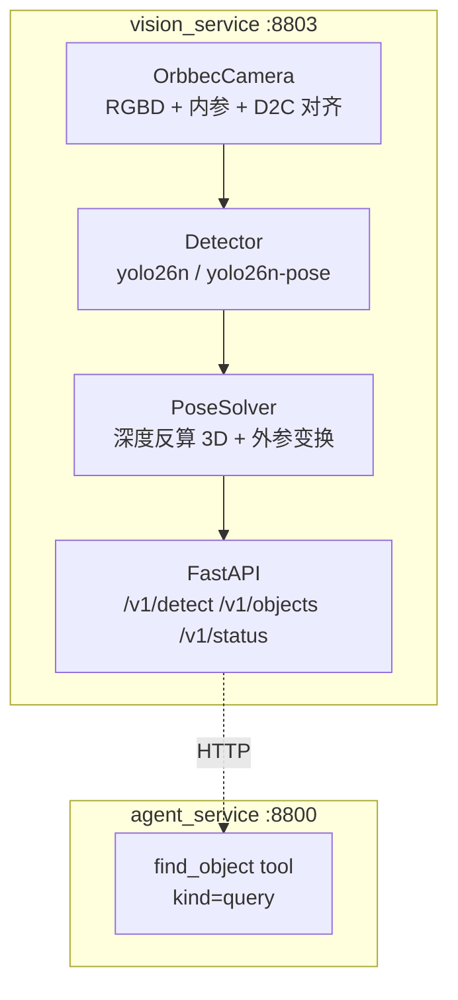

# 视觉服务 (vision_service)

Orbbec Gemini 336L 采集 RGBD -> YOLO 做物体检测/姿态估计 -> 深度反算目标
三维位置 -> 通过 Agent 的 `find_object` tool 支持语音查询。

**端口**: 8803 &nbsp;|&nbsp; **conda 环境**: `yolo` &nbsp;|&nbsp;
**本阶段不做机械臂控制**, 只产出位置数据。

---

## 1. 快速开始

```bash
# 1. 启动服务 (脚本里已经设好 LD_LIBRARY_PATH 等环境变量)
./scripts/start_vision.sh

# 2. 看状态
curl -s http://127.0.0.1:8803/health | python -m json.tool

# 3. 触发一次检测
curl -s -X POST http://127.0.0.1:8803/v1/detect \
     -H 'Content-Type: application/json' -d '{"conf": 0.25}' | python -m json.tool

# 4. 查某个物体
curl -s http://127.0.0.1:8803/v1/objects/bottle | python -m json.tool
curl -s http://127.0.0.1:8803/v1/objects/瓶子   | python -m json.tool  # 中文也行

# 5. 看相机到底识别到了什么 (最常用)
conda run -n yolo python services/vision_service/tools/check_recognition.py --http

# 6. 跑自检 (服务在跑的时候自动跳过直接开相机的检查)
conda run -n yolo python services/vision_service/tools/check_vision.py
```

---

## 2. 架构



### 文件清单

| 文件 | 职责 |
|---|---|
| `services/vision_service/config.py` | 配置加载 (yaml + env), 沿用 arm_service 的三层优先级 |
| `services/vision_service/camera.py` | Orbbec 封装: 枚举/打开/采集/内参/D2C 对齐 |
| `services/vision_service/detector.py` | YOLO 检测 + pose 封装 |
| `services/vision_service/solver.py` | 深度采样 + 3D 反算 + 外参变换 |
| `services/vision_service/extrinsic.py` | 外参 provider (静态/动态) + 坐标变换工具 |
| `services/vision_service/arm_kinematics.py` | arm_service 运动学客户端 (动态外参用) |
| `services/vision_service/calibration/` | 标定模块: ChArUco 板 / 内参 / 手眼 / 采集 |
| `services/vision_service/tools/make_board.py` | 生成可打印的 ChArUco 标定板 |
| `services/vision_service/tools/calib_intrinsics.py` | 内参标定 |
| `services/vision_service/tools/calib_handeye.py` | 手眼标定 |
| `services/vision_service/tools/calib_verify.py` | 标定验证 (含手性检查) |
| `services/vision_service/tools/apply_calibration.py` | 标定结果写回配置 |
| `services/vision_service/tools/check_calibration.py` | 标定数学自检 (合成数据) |
| `services/vision_service/solver.py` | 像素+深度 -> 3D; 手眼外参变换 |
| `services/vision_service/class_names.py` | 中英文类别名互译 (「瓶子」<-> `bottle`) |
| `services/vision_service/models.py` | Pydantic 请求/响应模型 |
| `services/vision_service/service.py` | 编排: 采帧 -> 检测 -> 解算 -> 缓存 |
| `services/vision_service/main.py` | FastAPI 入口 |
| `services/vision_service/tools/check_*.py` | 分项自检 + 总体自检 |
| `configs/vision.yaml` | 配置 |
| `scripts/start_vision.sh` | 启动脚本 |
| `services/agent_service/vision_client.py` | Agent 侧的 HTTP 客户端 |

---

## 3. 环境准备 (重要)

### 3.1 必须从源码编译 SDK (USB 后端)

pip 装的 `pyorbbecsdk` wheel **没有编译 USB PAL**, 直接用会报:

```
Usb pal is not exist, please check the build config that you have enabled BUILD_USB_PAL
```

然后 `ctx.query_devices()` 返回 0 个设备 —— 相机永远连不上。

解决: 从源码编译, 打开 USB/Net PAL:

```bash
cd /home/gxh/workspace/project/OrbbecSDK_v2
mkdir -p build && cd build
cmake .. -DOB_BUILD_USB_PAL=ON -DOB_BUILD_NET_PAL=ON
make -j$(nproc)
```

运行时让 Python binding 加载我们编出来的 `libOrbbecSDK.so.2`:

```bash
export LD_LIBRARY_PATH=/home/gxh/workspace/project/OrbbecSDK_v2/build/linux_x86_64/lib:$LD_LIBRARY_PATH
```

`scripts/start_vision.sh` 里已经带上了这行。

### 3.2 udev 规则

```bash
sudo cp /home/gxh/workspace/project/OrbbecSDK_v2/scripts/env_setup/99-obsensor-libusb.rules /etc/udev/rules.d/
sudo udevadm trigger && sudo udevadm settle
```

规则里已含 Gemini 336L 的 `0807` 条目。装完 `ctx.query_devices()` 应能看到 1 个设备。

### 3.3 Python 依赖

```bash
conda activate yolo
pip install fastapi uvicorn pyyaml websockets
```

`pyorbbecsdk` / `ultralytics` / `torch` / `opencv` / `numpy` 都已就位。

---

## 4. 相机与深度对齐 (踩过的坑)

### 4.1 深度/彩色必须**逐像素对齐**

这是整套流程里最关键的一步。彩色图上做检测, 深度图上取距离 —— 两张图
必须一一对应, 否则查到的是完全无关的东西。

Gemini 336L 的实际情况:

| 项 | 值 |
|---|---|
| 彩色流 | 1280 x 800, fx=609.93, fy=610.00, cx=638.55, cy=405.24 |
| 深度流 (原始) | 848 x 480, fx=415.69, fy=415.69, cx=422.68, cy=241.99 |
| 深度->彩色外参 | 平移 (-23.75mm, 0, 0.35mm), 旋转近似单位阵 |

**坑 1: `config.set_align_mode(SW_MODE)` 对这台相机没用。**
它不会真的把深度投影到彩色坐标系, 只是设了个标记。深度图仍然是
848x480 的原始深度, 跟 1280x800 的彩色图错位。

**坑 2: 硬件 D2C (`HW_MODE`) 不支持。**
启动时会报 `Current stream profile is not support hardware d2c process`。

**正确做法: 用 SDK 的 `AlignFilter`。**
它是 SDK v2 里真正做软件 D2C 的组件 —— 把 frameset 丢给它, 返回的
深度帧已经按彩色相机的光轴重投影过, 分辨率也跟彩色一致:

```python
align = ob.AlignFilter(ob.OBStreamType.COLOR_STREAM)
align.set_match_target_resolution(True)
align.set_align_to_stream_profile(color_profile)
...
frames = align.process(frames)     # frames 里的深度图已经是彩色坐标系的
```

对齐之后: 深度图 = 1280x800, 深度内参 = 彩色内参, 外参 = 单位阵。

`camera.py` 里的策略是: 依次尝试 `HW_MODE` -> `SW_MODE` -> `DISABLE`,
非 `HW_MODE` 时一律挂上 `AlignFilter` 做软件对齐。

**对齐正确性的验证方法** (`tools/debug_align_valid.py` 思路):
拿原始深度帧, 按内参+外参手工投影到彩色像素, 再跟 `AlignFilter`
的输出逐像素比 —— 实测深度差中位数 0.002m, 掩码一致率 0.46
(手工投影是前向 splat, 有空洞, 一致率天然低于 1)。

### 4.2 深度的单位

SDK 的 `get_depth_scale()` 返回 **1.0**, 意思是「原始值就是毫米」。
所以换算成米要乘 `0.001`:

```python
depth_m = raw_uint16.astype(np.float32) * (depth_scale * 0.001)
```

不乘的话距离会差 1000 倍。另外原始值 `65535` 是无效深度, 要滤掉。

### 4.3 深度是**稀疏**的

实测整帧有效率只有 **27%~40%** —— 反光/透明的物体表面更是成片空洞。
这是真实相机的常态, 采样算法必须考虑这一点 (见下一节)。

相机的深度工作模式 (`device.get_depth_work_mode_list()`) 有:
`Default` / `AMR with IR-Pass` / `High Accuracy` / `Factory Calib`。
实测 `High Accuracy` 反而更稀疏 (29%), `Default` 最均衡。

---

## 5. 深度采样算法 (`solver.py`)

### 5.1 目标

在检测框里找出**物体表面**的深度, 避开背景。

难点:
- 框里不只有物体 —— 细长的物体 (瓶子、杆子) 的框里大部分是背景
- 深度稀疏, 中心一点很可能落在空洞上
- 玻璃/反光物体表面整片没有深度

### 5.2 做法: 最近有效像素 + 按深度聚类

```
1. 找**离框中心最近的有效深度像素** —— 那一定是物体本身 (背景在框边缘)
2. 以它的深度为种子, 把整框里深度跟种子接近的像素收进来
   (容差 = 种子深度的 15%, 至少 5cm; 样本不够就逐级放宽到 25/40/60%)
3. 这批像素的中位数 = 锚点 (物体表面深度)
4. 再按锚点做网格采样取中位数, 避开边缘的深度跳变
```

**为什么不用别的方法**:

| 方法 | 问题 |
|---|---|
| 取中心一个像素 | 稀疏深度下大概率落在空洞上 |
| 整框中位数 | 一半前景一半背景时, 会落到中间那个**不存在的深度**上 |
| 整框众数 | 细长物体框里背景像素远多于物体像素, 众数落到背景上 |
| 局部小块众数 | 局部块一大就把背景囊进来了 (细长物体尤其明显) |

### 5.3 可信度判定

- `depth_valid = True` 需要: 锚点在框**内圈** (切比雪夫半径 <= 框尺寸
  的 40%) 找到 + 聚类后至少 5 个有效像素 + 表面占比 >= `min_valid_ratio`
- `valid_ratio` = 物体表面像素 / 全部有效深度像素。深度稀疏时天然偏低,
  所以默认阈值只配 `0.05` (不是 0.3)
- 不可信时返回 `depth_valid: false` 和 `x=y=0`, **不报假坐标**

### 5.4 置信度阈值要分两档

- `detector.conf` (0.35) —— 通用检测, 用来生成场景里的目标列表
- `detector.find_conf` (0.15) —— **按名字查找物体**时用

原因: 用户明确点名了要找什么, 就该尽力去找。用 0.35 会漏掉置信度
0.2~0.3 的目标 (半遮挡的瓶子、远处的杯子), 服务回答「没有看到」,
明明目标就在画面里。

### 5.5 3D 反算

```
Z = 深度 (米)
X = (u - cx) * Z / fx        u = 彩色图上的像素坐标
Y = (v - cy) * Z / fy
```

输出**相机坐标系** (OpenCV 约定): X 向右, Y 向下, Z 向前。

---

## 6. 手眼外参

外参把**相机坐标系**的坐标换到**目标坐标系**。目标系有五种:

| `target_frame` | 含义 | 什么时候用 |
|---|---|---|
| `camera` | 相机系 (默认) | 外参没标, 或者只是想问「离相机多远」 |
| `world` | 世界系 | 相机在躯干上, 头固定 —— 静态外参即可 |
| `arm_base` | 机械臂基座系 (按 `arm` 选左/右) | 双臂, 需要运行时基座位姿 |
| `left_base` | 左臂基座系 | 给左臂下抓取指令 |
| `right_base` | 右臂基座系 | 给右臂下抓取指令 |

**`matrix_frame` 说明标定出来的矩阵描述的是「相机 -> 哪个系」**:

| `matrix_frame` | 含义 |
|---|---|
| `world` | 标定时直接解出的 `T_world_cam` (眼在手外, 板挂工具) |
| `head` | `T_head_cam` (相机 -> 头座) —— **头会动时用**, 运行时补 `T_world_head(q_head)` |
| `arm_base` | `T_base_cam` (相机 -> 某条臂基座), 静态量 |

### 6.1 配置

```yaml
vision:
  extrinsic:
    enabled: false
    # 4x4 齐次矩阵 (行主序) —— 相机系 -> 目标系
    matrix: []
    rotation: []
    translation: [0.0, 0.0, 0.0]

    matrix_frame: "world"     # world / head / arm_base
    target_frame: "world"      # camera / world / arm_base / left_base / right_base
    arm: "auto"                # target_frame=arm_base 时用哪条臂
    dynamic: false             # 多臂分档 / 头部补偿时需要 true

    # 相机系 -> 基座系的轴置换。建议把置换烘进 matrix, 这里置 false。
    flip_axes: false
```

**未标定时 `enabled: false`**, 服务只输出相机坐标系, 并在响应里标
`"frame": "camera"` —— 不假装是基座坐标。

### 6.2 轴置换 (重要)

相机系 (OpenCV) 与基座系 (ROS/URDF) 差一个**轴置换**:

```
M = [[ 0,  0,  1],      相机前 -> 基座前 (+X)
     [-1,  0,  0],      相机右 -> 基座 -Y
     [ 0, -1,  0]]      相机下 -> 基座 -Z
```

行列式 = **+1** (是旋转, 不是镜像)。

> **历史包袱**: 老版本的 `flip_axes` 做的是 `(-x, -y, z)` —— 那是**绕光轴
> 转 180°**, 跟注释里写的语义对不上。现已改成正确的轴置换。
> **推荐做法**: 把置换烘进 `matrix`, `flip_axes` 置 `false` —— 一切都在
> 矩阵里, 不会有隐式变换把标定结果带偏。

### 6.3 动态外参 (世界系)

```
T_world_cam = T_world_base · T_base_cam
```

- `T_base_cam` — 标定出来的静态量
- `T_world_base` — 运行时从 `arm_service /v1/kinematics` 拿

配置 `dynamic: true` 后, 视觉服务每次检测前会
拉一次基座/头位姿。**拿不到时返回 `None`** —— 宁可退回相机系, 也不
要编一个错的坐标。

**双臂分档**: 双臂各有基座, 「相机 → 左臂基座」和「相机 → 右臂基座」
是两个不同的矩阵:

```
T_left_cam  = (T_world_base_left)⁻¹  · T_world_cam
T_right_cam = (T_world_base_right)⁻¹ · T_world_cam
```

差的那一项由控制器给 (`base_frame`), 你不用自己填。

**头部补偿** (头会动时): 标定量改成相对头座的 `T_head_cam`, 运行时补上
`T_world_head(q_head)`。详见[标定指南](calibration.md)的「头会动怎么办」。

### 6.4 标定流程

详见 [标定指南](calibration.md)。简要:

```bash
# 1. 生成并打印标定板 (100% 尺寸!)
conda run -n yolo python services/vision_service/tools/make_board.py

# 2. 标内参
conda run -n yolo python services/vision_service/tools/calib_intrinsics.py --capture

# 3. 手眼标定 (板挂工具, 用控制器正解当量尺)
conda run -n yolo python services/vision_service/tools/calib_handeye.py --capture

# 4. 验证 (含左右手性检查 —— 不能省!)
conda run -n yolo python services/vision_service/tools/calib_verify.py --samples /tmp/handeye_samples.json

# 5. 写回配置
conda run -n yolo python services/vision_service/tools/apply_calibration.py --all
```

### 6.5 内参覆盖

SDK 给的是**标称内参**, 实测差 1~2% (1.5 m 处就是 15 mm)。标定后填进
`camera.calibrated_intrinsics`, 服务的内参就会用标定值。

**内参是跟着分辨率走的** —— 改了彩色流分辨率必须重标。服务启动时会检查
分辨率对不对, 对不上会拒绝使用并打日志。

---

## 7. API

| 方法 | 路径 | 说明 |
|---|---|---|
| GET | `/health` | 相机连接状态、模型、GPU/CPU、坐标系、标定状态 |
| GET | `/v1/status` | 最近一次检测摘要 + 聚合 summary |
| POST | `/v1/detect` | 触发一次检测, 返回全部目标 |
| GET | `/v1/objects` | 取最近一次检测结果 (缓存) |
| GET | `/v1/objects/{name}` | 按类别名取目标 (Agent 用这个) |
| GET | `/v1/summary` | 按类别聚合的摘要 |
| GET | `/v1/frames` | 一次给出所有坐标系下的同一个点 (调试标定用) |
| GET | `/v1/calibration` | 标定状态 (内参标没标 / 外参配没配 / 有没有坑) |
| WS | `/ws` | 持续推送检测结果 (发数字改间隔, `stop` 断开) |

### GET /v1/calibration

一眼看出「现在报的坐标可不可信」:

```json
{
  "intrinsics": {
    "calibrated": false,
    "note": "内参未标定 —— 用的是 SDK 标称值, 1.5 m 处可能有 15 mm 误差"
  },
  "extrinsic": {
    "configured": false,
    "dynamic": false,
    "ready": true,
    "target_frame": "world",
    "matrix_frame": "world",
    "arms_available": [],
    "head_compensation": false,
    "head_frame_available": false,
    "note": "外参未配置 —— 只能报相机坐标系",
    "warnings": []
  },
  "frame": "camera"
}
```

### GET /v1/frames

一次给出所有坐标系下的同一个点 —— **调试标定最直接的接口**。

```bash
curl -s "http://127.0.0.1:8803/v1/frames?x=0&y=0&z=1" | python -m json.tool
```

```json
{
  "camera":    {"x": 0.0, "y": 0.0, "z": 1.0},
  "world":     {"x": 1.0, "y": 0.0, "z": 2.5},
  "left_base": {"x": 1.0, "y": -0.4, "z": 2.5},
  "right_base":{"x": 1.0, "y": 0.4, "z": 2.5},
  "sources": {
    "camera": "camera",
    "world": "static_matrix",
    "left_base": "base_frame:left",
    "right_base": "base_frame:right",
    "arm_base": "base_frame:auto"
  },
  "unavailable": [],
  "provider": {"arms_available": ["left", "right"], "head_compensated": false}
}
```

**变换不了的系会进 `unavailable`** —— 宁可少给一个系, 也不给错的。
`sources` 标明每个坐标是怎么来的, 出问题时能一眼定位。

### 怎么看「相机识别到了什么」

有三条路, 按场景选:

| 场景 | 命令 |
|---|---|
| **默认** (按配置走) | `conda run -n yolo python tools/check_recognition.py` |
| 强制走 HTTP | `... --http` |
| 强制直连相机 | `... --live` |
| 只看某几类 / 放宽阈值 | `... --classes cup,bottle --conf 0.05` |
| 连续盯一会儿 (看是不是偶尔才认出来) | `... --http --watch 30` |

**默认模式来自配置** (`configs/vision.yaml` 的 `vision.recognition.mode`),
默认是 `live`:

```yaml
recognition:
  mode: "live"     # live | http
  conf: 0.05       # 测试用阈值 (比服务的 detector.conf 松)
  frames: 5        # live 模式试几帧
  output_dir: "logs"
```

> **相机是独占的** —— 视觉服务在跑的时候, 别的进程开不了相机
> (报 `uvc_open failed -6`)。所以 `live` 模式在检测到服务在线时会
> **自动切到 HTTP** 并提示一行。命令行 `--http` / `--live` 优先级
> 高于配置, 但 `live` 遇到服务在线仍会自动让位 (避免把服务搞挂)。

输出长这样:

```
=== 第 1 次检测 (耗时 1774 ms, 坐标系 camera) ===
  类别                   置信度  bbox (x1,y1,x2,y2)         3D 位置 (x,y,z)              深度
  --------------------------------------------------------------------------------------------
  knife              0.296  (1010,525,1244,684)        (0.343,0.140,0.429) camera 有效
  remote             0.222  (633,414,948,626)          (0.081,0.061,0.323) camera 有效
  dining table       0.153  (26,406,1268,794)          (0.004,0.105,0.331) camera 有效
  cup                0.151  (358,33,714,703)           (-0.055,-0.020,0.326) camera 有效
```

`--live` 模式还会把标注图存到 `logs/vision_recognition.png` (框画得对不对,
肉眼看最快), 原图存 `logs/vision_color.png`。

**置信度阈值的坑**: 默认 `conf: 0.35` 相当严格 —— 实测普通桌面场景
(杯子/刀/遥控器) 常落在 **0.10~0.30**。看不到东西时先用 `--conf 0.05`
确认「模型到底认出没」, 再考虑是阈值问题还是模型/光照问题。

### POST /v1/detect 请求体

```json
{
  "conf": 0.35,
  "classes": ["bottle", "cup"],
  "pose": false,
  "frame": "camera"
}
```

### 响应示例

```json
{
  "objects": [
    {
      "label": "bottle",
      "confidence": 0.2584,
      "bbox": {"x1": 953.9, "y1": 162.4, "x2": 1118.5, "y2": 605.3},
      "pose": {
        "x": 0.3018, "y": -0.0162, "z": 0.463,
        "depth_valid": true,
        "valid_ratio": 0.112,
        "depth": 0.463,
        "frame": "camera"
      }
    }
  ],
  "latency_ms": 29,
  "timestamp_us": 1762830000000000,
  "frame": "camera"
}
```

`/v1/objects/{name}` 支持中文名 (「瓶子」-> `bottle`), 映射表在
`class_names.py`。

---

## 8. Agent 集成

### 8.1 tool 定义 (`configs/tools.yaml`)

```yaml
  - name: find_object
    kind: query
    label: 找物体
    description: 用相机查找某个物体的位置。用户问「XXX 在哪」「看看有没有 XXX」「XXX 在什么位置」时使用。返回该物体的三维坐标。
    action_map:
      "": find_object
    parameters:
      type: object
      properties:
        name:
          type: string
          description: 要找的物体名称, 如 杯子、苹果、瓶子
        frame:
          type: string
          enum: ["camera", "world", "arm_base", "left_base", "right_base"]
          description: camera=相机坐标系(默认, 总是可用); world=世界坐标系(需要手眼标定); arm_base/left_base/right_base=机械臂基座坐标系(需要手眼标定 + 运行时基座位姿)
      required: ["name"]
```

### 8.2 关键文件

| 文件 | 作用 |
|---|---|
| `services/agent_service/vision_client.py` | 异步 HTTP 客户端 (`find_object` / `detect`) |
| `services/agent_service/handlers/tool_handler.py` | `find_object` 的规则匹配 + 执行 + 播报文案 |
| `services/agent_service/router.py` | `_needs_vision_lookup()` —— 检测 LLM 是否在编造坐标, 是则用 `tool_choice=required` 重试 |

### 8.3 播报文案示例

```
找到瓶子，距离相机 0.46 米，往右 0.30 米，往下 -0.02 米
没有看到杯子
```

### 8.4 四个防呆

- **机械臂肢体问题不能被 `find_object` 截胡**: 「左手在哪」这类问题
  走机械臂的关节查询, 不查相机。
  正则匹配路径有 `_is_arm_query` 挡着, 但 **LLM 直接生成 tool call 时
  不走正则** —— 模型会老老实实填 `name="左手"`, 于是相机去查「左手」,
  答一句「没有看到左手」。所以 `router.py` 的 tool 调用路径里也加了
  同样的检查。
- **防幻觉**: LLM 有时会直接编一个坐标而不调 tool。`router.py` 里的
  `_needs_vision_lookup()` 会识别出这类请求, 强制 `tool_choice=required`
  重试一次。
- **计数型提问也要实测**: 「桌上有几个瓶子」的答案只能靠相机数。
  模型说「有 3 个」就是编的, 所以这类句子也要触发 `required` 重试。
- **量词要必需**: 「几点」是查时间, 「几个」才是数东西 ——
  正则里量词写成必需, 否则「现在几点」会被误判成视觉查询。

### 8.5 计数型提问的物体名提取

「桌上有几个瓶子」直接送去做类别匹配是查不到东西的 ——
残留的「桌上」「有」「几个」不是物体名的一部分。

`tool_handler._guess_label()` 的处理顺序:

```
1. 剥疑问词/动作词 (在哪、找一下、看看、有没有…)
2. 剥计数词  (几个、还剩几个、多少)      -> 「桌上有几个瓶子」→「桌上瓶子」
3. 剥时间前缀 (现在、目前、今天)        -> 「现在椅子」
4. 剥方位前缀 (桌上、柜子上、周围)      -> 「瓶子」
   **剥之前先看剥完是否还剩东西** —— 「椅子」里的「椅」如果被当成
   方位词剥掉, 就只剩个「子」了
5. 只保留中英文数字
```

### 8.6 Agnes API 速率限制 (429)

免费额度下 API 会返回 **429 速率限制**。症状是:

```
[router] 检测到 vision-miss (...), 用 required 重试
[router] required 重试失败: HTTP 429 速率限制: ...
```

看起来像「重试逻辑有问题」, 实际是**被限流了**。

`llm.py` 的 `_post()` 对 429 单独处理:

- 优先用服务端的 `Retry-After` 头
- 没有就用指数退避 (2.5s / 5s / ...)
- 普通错误的退避只有 1s, 对限流窗口来说太短 —— 重试必然再撞 429

实测连续 8 次请求会有 4~5 次 429, 间隔 0.3s 时尤其明显。

---

## 9. 配置 (`configs/vision.yaml`)

配置来源优先级 (后者覆盖前者):

1. 代码内的默认值
2. `configs/vision.yaml`
3. 环境变量 (`VISION_*`)

```yaml
vision:
  server:  { host: "0.0.0.0", port: 8803 }
  camera:
    serial_number: ""            # 留空 = 第一个枚举到的设备
    width: 0                     # 0 = 用相机默认模式
    height: 0
    fps: 0
    frame_timeout_ms: 2000
    align_depth_to_color: true   # 关掉就退化成「按内参映射 bbox」(精度差)
    calibrated_intrinsics: {}    # 标定好的内参 (见标定指南)
  detector:
    weights: "/home/gxh/workspace/project/ultralytics/yolo26n.pt"
    pose_weights: ""             # 留空 = 不启用姿态估计
    conf: 0.35
    find_conf: 0.15              # 按名字查找时的阈值 (比 conf 宽松)
    iou: 0.5
    device: auto                 # auto / cpu / 0
    imgsz: 640
    max_objects: 20
  solver:
    sample_grid: 5
    min_valid_ratio: 0.05        # 深度稀疏, 阈值不能高
    depth_min: 0.1
    depth_max: 5.0
  extrinsic:
    enabled: false
    matrix: []                   # 4x4 齐次矩阵 (相机系 -> matrix_frame 描述的系)
    rotation: []
    translation: [0.0, 0.0, 0.0]
    matrix_frame: "world"        # world / head / arm_base
    target_frame: "world"        # camera / world / arm_base / left_base / right_base
    arm: "auto"                  # target_frame=arm_base 时用哪条臂
    dynamic: false               # 多臂分档 / 头部补偿时需要 true
    flip_axes: false              # 轴置换建议烘进 matrix
    arm_service_url: "http://127.0.0.1:8802"
```

标定板规格在单独的 `configs/calibration.yaml` 里 (内参/外参标定结果分别
存到 `configs/intrinsics.json` 和 `configs/handeye.json`)。

---

## 10. 自检

```bash
# 总体自检 (配置/相机/检测器/解算/HTTP/arm_service/Agent)
conda run -n yolo python services/vision_service/tools/check_vision.py

# 分项
conda run -n yolo python services/vision_service/tools/check_camera.py
conda run -n yolo python services/vision_service/tools/check_detector.py
conda run -n yolo python services/vision_service/tools/check_solver.py
conda run -n yolo python services/vision_service/tools/check_e2e.py

# 标定数学的自检 (不需要相机/机械臂, 合成数据)
conda run -n yolo python services/vision_service/tools/check_calibration.py

# 只跑某几项
conda run -n yolo python services/vision_service/tools/check_vision.py --only config,solver
```

**注意**: 相机是**独占**的 —— 服务在跑的时候, 自检脚本再开一次会报
`uvc_open failed: Return Code: -6`。脚本会自动探测 `/health`, 服务在跑
就跳过直接开相机的检查, 改走 HTTP。

当前的通过情况: **50 项全绿**, 位姿解算的 Z 误差 **0.0 cm**;
标定自检 **26 项全绿** (合成数据下平移误差 0.0000 mm)。

> **沙箱/代理注意**: 如果在带 `HTTP_PROXY` 的环境里跑自检, 回环请求
> 会被代理接管而连不上自己 —— 脚本里的 HTTP 请求显式用了
> `ProxyHandler({})` 绕过代理, `VisionClient` 也设了 `trust_env=False`。

---

## 11. 已知限制

| 限制 | 说明 |
|---|---|
| 相机独占 | 同一时刻只能有一个进程开相机 (自检脚本已做探测) |
| 深度稀疏 | 整帧有效率 27%~40%; 反光/透明物体表面会整片没有深度, 此时 `depth_valid=false` |
| 硬件 D2C 不支持 | Gemini 336L 的硬件 D2C 不可用, 走软件 `AlignFilter` (实测误差 2mm, 可接受) |
| 内参/外参未标定 | 默认用 SDK 标称内参 + 相机系输出。响应里明确标 `"frame": "camera"`, `/v1/calibration` 能查状态 |
| 姿态模型未启用 | `pose_weights` 留空, 需要时填 `yolo26n-pose.pt` |
| 不做机械臂控制 | 本阶段只产出位置数据 |

---

## 12. 下一步

1. **完成标定**: 按 [标定指南](calibration.md) 标内参 + 手眼标定,
   然后把 `extrinsic.enabled` 打开, 让 `/v1/objects/{name}?frame=arm_base`
   能返回基座坐标
2. **接入机械臂**: 用 `find_object` 返回的基座坐标驱动机械臂抓取
3. **多相机/多目标跟踪**: 目前每帧独立检测, 没有跟踪
