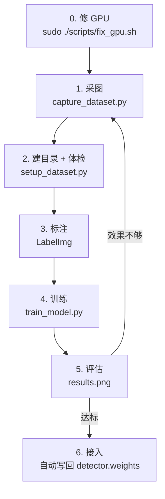

# 训练自定义 YOLO 模型

给机器人的抓取目标训练专用检测模型 —— 覆盖 COCO 通用物品和自定义工件。

**前置**: 相机服务跑在 `yolo` 环境, 训练用同一套环境。

---

## 0. 为什么必须自己训

现在用的是 COCO 预训练的 `yolo26n.pt`，类别集合**固定在 80 类**：

```
person, bicycle, cup, bottle, knife, dining table, remote, bowl, ...
```

你的工件不在这 80 类里的话，YOLO **在原理上就检不出来** —— 不是阈值问题，
调 `conf` 到 0.01 也没用，因为模型根本没有那个类别的神经元。

实测你的场景（`logs/vision_recognition.png`），yolo26n 把 `knife` 检出两次、
`dining table` 框住整张图 —— 它是在**瞎猜**，靠通用特征硬凑，不是真的理解。

---

## 1. 完整流程



### 步骤 0：确认 GPU 可用

```bash
bash scripts/fix_gpu.sh --check
```

必须看到 `cuda available: True`。训练在 CPU 上要几小时到几天，完全不可用。

**如果 `nvidia-smi` 报 "couldn't communicate with the NVIDIA driver"**：

驱动内核模块其实是好的，只是 `/dev/nvidia*` 设备节点没建出来
（udev 规则里的 `ub-device-create` 只在 PCI 驱动 bind 那一刻触发，
模块要是加载得早就永远建不出来）。

```bash
sudo ./scripts/fix_gpu.sh
```

脚本会先试 udev 触发，不行就按 `/proc/devices` 里的 major 号手工 `mknod`。

---

### 步骤 1：采图

> **相机是 USB 独占的** —— 视觉服务在跑的时候开不了相机。
> 先 `./scripts/stop_all.sh`。

```bash
cd services/vision_service

# 先检查相机能不能开
conda run -n yolo python tools/capture_dataset.py --check

# 采 300 张
conda run -n yolo python tools/capture_dataset.py --count 300
```

采出来的是**和线上推理同一路画面**（同分辨率、同 D2C 对齐、同色彩），
不会有"训练用一套图、部署用另一套图"的域差。

**覆盖度比数量重要**。采的时候主动变化这些维度：

| 维度 | 建议覆盖 |
|---|---|
| 距离 | 0.3 / 0.6 / 1.0 / 1.5 m（相机在头部，距离跨度大） |
| 角度 | 正对 / 斜 45° / 俯视 / 侧视 |
| 光照 | 正常 / 偏暗 / 强反光 |
| 背景 | 不同工位 / 不同桌面材质 |
| **负样本** | 画面里**没有**目标物体（防误检，抓取场景尤其重要） |

混采负样本：

```bash
conda run -n yolo python tools/capture_dataset.py --count 300 --negative-ratio 0.2
```

采完脚本会打印距离档位分布和负样本占比 —— 占比不足会警告。

---

### 步骤 2：建目录 + 体检

```bash
conda run -n yolo python tools/setup_dataset.py \
  --out /home/gxh/workspace/project/datasets/myobjects \
  --names 杯子,瓶子,螺丝
```

**类名直接决定 `find_object` 能不能匹配上**，详见[第 5 节](#5-类名必须匹配)。

标完之后再体检一次：

```bash
conda run -n yolo python tools/setup_dataset.py \
  --out /home/gxh/workspace/project/datasets/myobjects --check
```

体检会找出：

- 漏标的图（**训练效果差的头号原因**）
- 标注框格式错 / 坐标越界 / 宽高非正
- 类别 id 超出 `data.yaml` 声明范围
- 类别分布严重不均衡
- **数据泄漏**（同一张图同时出现在 train 和 val，验证指标虚高）

---

### 步骤 3：标注

```bash
conda run -n yolo pip install labelImg
conda run -n yolo labelImg
```

打开 `images/train` 目录开始标，标签自动存到对应的 `labels/` 目录。

YOLO 格式每行：`class_id x_center y_center width height`（**归一化 0~1**）。

**标注质量要点**：

- 框要**贴紧**物体 —— 抓取点靠框内深度采样算出来的，框松了抓取点就偏
- 遮挡目标按可见部分框
- 负样本的图片**不建 txt**（"有图无 label"就是负样本）
- 别漏标 —— 漏标的图会被当成"这里没有目标"，直接教模型误检

> **先标 30~50 张跑一次**，看效果再补标剩下的。比一次性标 500 张高效得多。

---

### 步骤 4：训练

```bash
conda run -n yolo python tools/train_model.py
```

脚本会：

1. **预检** —— GPU 可用性、起点权重、数据集（漏标/格式/泄漏）
2. 训练（参数读 `configs/vision.yaml` 的 `vision.training` 段）
3. 读 `results.csv` 打印 mAP50 / precision / recall
4. **自动把 `best.pt` 写回** `configs/vision.yaml` 的 `detector.weights`

只预检不训练：

```bash
conda run -n yolo python tools/train_model.py --check
```

临时改参数：

```bash
conda run -n yolo python tools/train_model.py --epochs 50 --batch 8 --no-apply
```

### 关键超参

配置在 `configs/vision.yaml`：

```yaml
training:
  base_weights: "/home/gxh/workspace/project/ultralytics/yolo26n.pt"
  epochs: 100
  imgsz: 640
  batch: 16        # 显存不够写 -1 (自动估算)
  patience: 30     # 早停
  device: "0"
  hsv_h: 0.01      # 工业件颜色常是关键特征, 颜色扰动调小
  mosaic: 1.0      # 小数据集上 mosaic 很有效
  close_mosaic: 10 # 最后 10 轮关掉, 收敛更稳
```

| 参数 | 说明 |
|---|---|
| `base_weights` | **用预训练权重做微调**，别从零训 —— 从零至少要几千张，微调 50~150 张就够 |
| `imgsz` | 物体占比小可以调到 960，但**推理延迟会跟着涨**，抓取要快就别调 |
| `batch` | 你的卡是 RTX A500 Laptop（4GB），640 分辨率下 16 应该够，OOM 就降 8 |
| `patience` | 早停，防过拟合 |

---

### 步骤 5：评估

训练产物在 `runs/detect/<name>/`：

| 文件 | 看什么 |
|---|---|
| `results.png` | 训练曲线。train loss 降但 val loss 升 = **过拟合** |
| `confusion_matrix.png` | 哪两类互相混淆 |
| `results.csv` | 逐 epoch 指标 |
| `weights/best.pt` | **用这个**（val 指标最好那轮） |

实机验证（记得先停服务，相机独占）：

```bash
conda run -n yolo python tools/check_recognition.py --live --classes 螺丝,杯子 --conf 0.15
```

`--live` 会把标注图存到 `logs/vision_recognition.png`。
**打开看框是否贴紧物体** —— 框松了抓取点就会偏。

如果效果不行，按这个顺序排查：

1. 漏标多 → 补标（`setup_dataset.py --check` 会告诉你漏了多少）
2. 数据太少 → 补图
3. 场景单一 → 换背景/角度/光照再采
4. 过拟合 → 加数据，或调 `hsv_*` / 关掉 `mosaic`
5. 置信度太低 → 先确认是"没检出"还是"检出但分数低"（用 `--conf 0.05` 对比）

---

### 步骤 6：接入

训练脚本已经自动写回了 `detector.weights`，**代码零改动**。

只需要重启视觉服务：

```bash
./scripts/stop_all.sh
./scripts/start_all.sh
```

验证：

```bash
conda run -n yolo python tools/check_recognition.py --http
```

---

## 5. 类名必须匹配

**这是最容易踩的坑。**

`find_object` 靠**类名字符串**匹配（`service.py` → `class_names.candidates()`）：

| 训练时类名 | 用户说 | 结果 |
|---|---|---|
| `螺丝` | "螺丝" | ✅ 匹配上（`translate()` 未命中映射时原样返回） |
| `screw` | "螺丝" | ❌ **查不到**（映射表里没有这条） |
| `screw` | "screw" | ✅ 匹配上 |

**所以自定义类别直接用中文命名**，用户用中文说话就能直接匹配。

如果一定要用英文名，得往 `services/vision_service/class_names.py` 的
`ZH_TO_CLASS` 补映射：

```python
"螺丝": "screw",
"扳手": "wrench",
```

改完重启 Agent 服务（映射表在服务启动时加载）。

---

## 6. 负样本与误检

自定义模型在没见过的背景上容易误检 —— 抓取场景下这很致命
（抓了个不存在的东西）。

防护手段：

1. **训练集保证负样本占 15~20%**（`capture_dataset.py --negative-ratio 0.2`）
2. `find_conf` 留余量（默认 0.15，比 `detector.conf` 松）
3. 误检严重时调高 `find_conf`，宁可漏检也不要抓错

---

## 7. 常见坑速查

| 现象 | 原因 | 怎么办 |
|---|---|---|
| `nvidia-smi` 报驱动错 | `/dev/nvidia*` 节点缺失 | `sudo ./scripts/fix_gpu.sh` |
| `uvc_open failed -6` | 相机被别的进程占着 | `./scripts/stop_all.sh` |
| USB 层看不到设备 | 相机没插好 / 供电不足 | 换 USB3 口、插紧、等 2 秒 |
| `Usb pal is not exist` | pip 装的 SDK 没有 USB 后端 | 用源码编译（`OB_BUILD_USB_PAL=ON`） |
| 训完 mAP50 很低 | 漏标 / 数据太少 / 场景单一 | `setup_dataset.py --check` 找问题 |
| 检出但抓取点偏 | 框没贴紧 | 重新标注，框贴紧物体 |
| `find_object` 说"没看到" | 类名对不上 | 见第 5 节 |
| 误检严重 | 负样本不够 | 补采负样本 |
| 训练 OOM | 显存不够 | `batch: 8` 或 `-1` |

---

## 8. 工具清单

| 脚本 | 作用 |
|---|---|
| `tools/capture_dataset.py` | 采图（含覆盖度统计、负样本混采） |
| `tools/setup_dataset.py` | 建目录 + 生成 data.yaml + **数据集体检** |
| `tools/train_model.py` | 训练（预检 + 自动写回权重 + 指标报告） |
| `tools/check_recognition.py` | 看识别到了什么（`--live` 直接开相机） |
| `tools/check_vision.py` | 全量自检 |

---

## 9. 目录约定

```
/home/gxh/workspace/project/datasets/myobjects/   ← 数据集 (项目外, 不入库)
├── images/{train,val}/
├── labels/{train,val}/
├── data.yaml
└── meta.json            ← 采图元信息 (距离档位等)

/home/gxh/workspace/project/runs/detect/<name>/    ← 训练产物
├── weights/{best,last}.pt
├── results.png / results.csv / confusion_matrix.png
```

数据集和权重都**不入库**（`.gitignore` 已兜底）。
